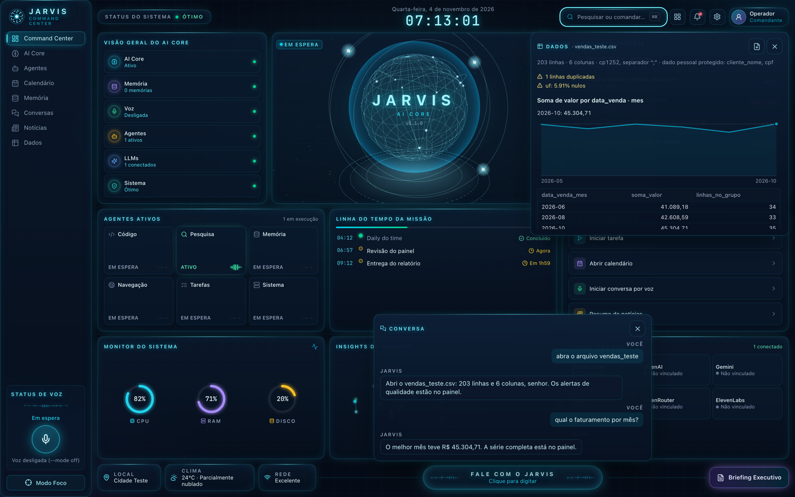

# J.A.R.V.I.S. para analistas de dados

Assistente de voz para o Mac, em português, que responde perguntas sobre planilhas CSV **sem mandar as linhas do arquivo para a IA**. Você pergunta "Ei Jarvis, qual UF mais fatura no arquivo de outubro?". O Claude escolhe a métrica e o agrupamento, o DuckDB faz a conta no seu Mac e o Jarvis confere cada número da resposta antes de falar.



<sub>Painel rodando com o daemon de teste e dados fictícios: arquivo aberto, alertas de qualidade (linha duplicada, UF nula), faturamento por mês e a conversa.</sub>

## O problema

Pedir a um assistente de IA que analise um CSV tem três riscos para quem trabalha com dados de empresa:

1. **Vazamento.** O arquivo inteiro, com CPF, nome e e-mail, vai para um serviço externo.
2. **Conta inventada.** O modelo pode errar uma soma ou "fazer de cabeça" um número que nenhuma consulta produziu.
3. **Arquivo do Excel brasileiro.** Um CSV em cp1252, com `;`, `R$ 1.234,56` e datas dd/mm/aaaa, quebra as ferramentas padrão. Nos testes, o DuckDB e o pandas falharam na leitura, e o detector de codificação `charset-normalizer` trocou "Promoção" por "Promoçăo".

O Jarvis trata cada risco com uma trava no código, não com uma instrução no prompt.

## Decisões de projeto

| Risco | Decisão | Alternativa descartada e por quê |
|---|---|---|
| Vazamento | O Claude não escreve SQL. Ele pede `{métricas, agrupar por, filtros}`, e a ferramenta monta a consulta a partir de uma lista fechada de funções. Grupos com menos de 5 linhas são omitidos (anonimato k). Colunas com dado pessoal só aceitam contagem. | **SQL livre:** devolvia até 50 linhas cruas. **Regra no prompt:** o modelo pode errar ou ser induzido pelo conteúdo de uma célula. |
| Conta inventada | Todo número sai do DuckDB ou de uma calculadora. Um validador extrai os números da resposta em formato brasileiro e troca por um aviso qualquer frase cujo número não apareça num resultado de ferramenta. | Confiar no modelo. |
| Execução de código | SQL roda no DuckDB travado (`enable_external_access=false`, `lock_configuration=true`). Python roda no sandbox Seatbelt do macOS, sem rede e com limites de CPU, tempo e memória. | **Docker:** isola também a memória, mas exige uma VM de cerca de 2 GB e soma 0,3 s por execução. |
| Leitura do arquivo | UTF-8 estrito, depois cp1252, e só então o detector genérico. Colunas de texto com 95% ou mais dos valores no padrão pt-BR viram número ou data. | **Detector genérico primeiro:** errou a codificação em dois dos arquivos de teste. |

## Resultados medidos

Os números vêm das provas de conceito em [`_pocs/`](_pocs/) e dos relatórios em [`docs/`](docs/). Todos foram medidos num MacBook Air M2.

- **Números rastreáveis:** em 5 perguntas reais ao Claude, os 32 números das respostas tiveram origem num resultado de ferramenta. Na primeira rodada, o validador deu 4 falsos positivos, que depois foram corrigidos. Quando foi convidado a "fazer de cabeça", o Claude recusou e calculou no SQL.
- **Bloqueios testados** (CSV sintético com CPF, nome e e-mail falsos):
  - Agrupar ou filtrar por coluna pessoal é recusado.
  - Agrupar por `valor_total` devolve 0 grupos e suprime 2.981.
  - A injeção `SP' or 1=1 --` num filtro vira texto literal.
  - Uma mensagem de erro que repetiria o conteúdo de uma célula é cortada.
- **Isolamento:** o mesmo script hostil foi rodado em quatro ambientes. Ele tentava ler e escrever fora da pasta, usar a rede, abrir um shell, rodar um laço infinito e alocar 2 GB. Sem isolamento, tudo passou. No DuckDB travado e no Seatbelt, a leitura, a escrita e a rede foram bloqueadas ([resumo](_pocs/p4_isolamento/RESUMO.md)).
- **Tamanho:** ler e perfilar 1 milhão de linhas (61 MB) leva 0,67 s. Com 5 milhões de linhas (309 MB), leva 2,46 s, com pico de 1,39 GB de memória.
- **Testes:** 118 testes unitários e uma suíte de ponta a ponta no Playwright, com Chromium e WebKit, cobrindo 76 itens do painel. Antes das correções, 36 dos 73 itens medidos falhavam ([relatório](docs/RELATORIO_TESTES.md)).

**Limites conhecidos:**
- O validador pega número inventado, mas não um número verdadeiro atribuído à coisa errada.
- Com só agregados, o Claude não faz junções nem funções de janela.
- O Jarvis só roda no macOS, porque usa AppleScript, Seatbelt e CGEventTap.

## Rodar

Pré-requisitos: macOS, [uv](https://docs.astral.sh/uv/), Node 20+ e o Claude Code instalado e logado (`claude`).

```bash
uv sync
cd ui && npm install && npm run build && cd ..
uv run jarvis
```

Na primeira vez:

1. O Whisper baixa o modelo `small`, uns 460 MB.
2. O macOS pede **Microfone**. Aceite.
3. Para o push-to-talk (Option direito), adicione o Terminal (ou o app em que você roda o Jarvis) em **Ajustes do Sistema › Privacidade e Segurança › Monitoramento de Entrada**. Depois feche e reabra o Terminal.
4. Na primeira ação em um app (fechar app, modo escuro), o macOS pede **Automação**. Aceite.

### Opções

| Comando | O que faz |
|---|---|
| `uv run jarvis` | Janela nativa + sempre ouvindo "Ei Jarvis" |
| `uv run jarvis --mode ptt` | Só escuta enquanto você segura o Option direito |
| `uv run jarvis --mode off` | Sem microfone; conversa digitando no painel |
| `uv run jarvis --no-window` | Sem janela; painel em http://127.0.0.1:8787 |
| `uv run jarvis --text "abre o Chrome"` | Um turno pelo terminal (`--speak` para falar a resposta) |
| `uv run jarvis --writes` | Libera ações que mudam o mundo (terminal, escrever arquivos, enviar) |

Variáveis em `.env` (todas opcionais): `JARVIS_MODEL` (padrão `claude-sonnet-5-5`), `JARVIS_EFFORT` (`low`), `JARVIS_WHISPER_MODEL` (`small`), `JARVIS_VOICE` (`Luciana`), `JARVIS_LOCATION` (cidade do clima; sem ela, a cidade sai do IP) e `ELEVENLABS_API_KEY` (troca a voz do macOS pela ElevenLabs).

## Notícias

Edite [`sources.json`](sources.json). Use `"modo": "rss"` com `"rss": "<url do feed>"` quando o site tiver feed. Sem feed, use `"modo": "html"` com um `padrao_link` que case com o caminho dos artigos. O Jarvis busca as fontes a cada 20 minutos, mostra as novas manchetes no feed e responde "quais as notícias do Data Hackers?".

**Resumo diário.** Todo dia às 08:00 (`JARVIS_RESUMO_HORA`; vazio desliga; se o Mac estava desligado, sai ao ligar) o Jarvis fala as três notícias mais relevantes das últimas 36 horas, uma frase própria para cada, e põe os links no feed. A relevância vem de `JARVIS_NOTICIAS_TEMAS` (lista separada por vírgulas) e do glossário de dados. Repetidas entre fontes saem; se a resposta repetir um trecho de oito palavras ou mais da fonte, o feed avisa. O botão "Resumo de notícias" faz o mesmo a qualquer hora, e o "Briefing Executivo" junta agenda, as três notícias e os arquivos de dados novos.

## Dados (CSV)

"Jarvis, abre o arquivo vendas de outubro" procura um `.csv` ou `.tsv` em Downloads, Documentos e Mesa (até três níveis abaixo; troque com `JARVIS_PASTAS_DADOS`, pastas separadas por `:`). O arquivo pode estar no padrão do Excel brasileiro (cp1252, `;`, vírgula decimal, `R$ 1.234,56`, datas dd/mm/aaaa). Depois pergunte: "qual UF mais fatura?", "e por mês?", "quanto seria com 12% a mais?".

- **Só agregados vão para o Claude.** Ele não lê o arquivo nem escreve SQL: pede métricas, agrupamentos e filtros, e o Jarvis monta a consulta. Grupos com menos de 5 linhas são omitidos (`JARVIS_K_ANONIMATO`). Colunas com cara de dado pessoal (CPF, nome, e-mail, telefone) só aceitam contagem. O `Read`/`Grep` do Claude não abre `.csv`, `.tsv`, `.xlsx`, `.xls` nem `.parquet`.
- **Todo número sai de uma ferramenta.** As contas vêm do DuckDB ou de uma calculadora; um número da resposta que não aparece em nenhum resultado vira o aviso "Número sem origem nos dados" no feed.
- O arquivo original nunca é alterado; a leitura acontece numa conexão do DuckDB sem acesso a outros arquivos nem à rede.
- **Painel "Dados".** Abre sozinho com o arquivo e cada resultado: tabela, gráfico (linha para meses e anos, barras para categorias) e os cinco últimos resultados. Arraste um CSV para o painel (ou use o botão de envio) e o Jarvis o abre; o arquivo fica em `data/arquivos` (limite em `JARVIS_UPLOAD_MAX_MB`).
- **Número sem origem não é falado.** Uma frase com número que não saiu das ferramentas é trocada por "Esse número não está confirmado nos dados" e marcada na conversa.
- **Também:** "o que mudou no arquivo de outubro?" compara versões (linhas iguais, novas e removidas, colunas, totais, categorias); "anota que UF vazia conta como Não informada" guarda a decisão, que volta quando o arquivo é reaberto; "NPS é promotores menos detratores" entra no glossário, que ajuda o Whisper a ouvir o termo; "isso se sustenta?" revisa o último resultado (tamanho da base, participação × risco, sazonalidade, causa).

### Python isolado e monitores

- **Estatística e gráficos.** "A diferença entre loja e e-commerce é significativa?", "faz uma regressão", "mostra a distribuição": o Claude escreve Python (pandas, numpy, scipy, matplotlib) que roda no sandbox do macOS (Seatbelt), sem rede, sem ler outros arquivos e sem executar programas, com limites de 30 s de CPU, 60 s e 1,5 GB (`JARVIS_PY_CPU_S`, `JARVIS_PY_PRAZO_S`, `JARVIS_PY_MEM_MB`). O código vê o arquivo inteiro, mas ao Claude só volta o que passa por `resultado()`: textos só se forem colunas ou categorias com 5+ linhas, tabelas só com a coluna `n` (grupos com menos de 5 saem), listas soltas até 20 itens. `print` e mensagens de erro com conteúdo de célula ficam no Mac. Os gráficos aparecem no painel e não vão para o Claude.
- **Monitores de KPI.** "Me avisa se o faturamento diário de SP cair mais de 10% contra a média dos 7 dias anteriores." O Jarvis confere de hora em hora (`JARVIS_KPI_INTERVALO_MIN`), sempre na versão mais recente do arquivo, e fala o alerta uma vez por período, sem passar pelo Claude. O dia ou mês em curso fica de fora para não alarmar à toa. Os monitores aparecem no painel "Dados".

### Análise profunda (plugin analise-dados)

"Jarvis, faz uma análise profunda do arquivo vendas de setembro" (ou "...da pasta projeto churn") abre uma sessão separada do Claude com o plugin [analise-dados](https://github.com/fernandofigueiredo-data/analise-dados-plugin): ela prepara o projeto, sobe o Jupyter, abre o notebook no navegador (`JARVIS_ABRIR_NOTEBOOK=0` desliga), pergunta a pergunta de negócio e conduz a análise célula a célula, com validação e revisão crítica. Um arquivo vira um projeto novo em `~/Documents/Análises Jarvis/<nome>` (`JARVIS_PASTA_ANALISES`) com uma cópia em `dados/`; uma pasta escolhida vira o próprio projeto (o plugin cria `.venv`, `dados/`, `saidas/` e `.claude/` nela). Enquanto o modo está aberto, o que você diz vai para a análise; só as duas primeiras frases de cada resposta são faladas. "Sai do modo profundo" encerra e desliga o Jupyter.

- **Aqui as linhas do arquivo vão para o Claude** (o resultado de cada célula volta para ele): exceção autorizada à regra dos agregados, só para a pasta ou o arquivo que você escolheu.
- A sessão tem política própria: Jupyter, skills e subagentes do plugin liberados; terminal só para os scripts do plugin; escrita só dentro do projeto e nunca em `dados/`; sem internet. As regras do projeto do plugin (não ler o `.env`, não editar `dados/`) valem.
- Requer o plugin instalado no Claude Code (`claude plugin install analise-dados@analise-dados`) ou `JARVIS_PLUGIN_ANALISE` apontando para ele.

## Apps

Edite [`apps.json`](apps.json): `"chave": "Nome do App"`. Para nomes que o Whisper erra, use a forma longa com `heard_as`.

## Segurança

- Por padrão o Jarvis só **lê**: as ferramentas de terminal e escrita nem existem na sessão do Claude. Ações locais e reversíveis (abrir apps, volume, timers) sempre funcionam.
- `setting_sources=[]` impede que regras do seu `~/.claude/settings.json` passem por cima desse bloqueio.
- O servidor escuta só em `127.0.0.1`, e o WebSocket só aceita o próprio painel como origem.

## Como funciona

```
mic → VAD → Whisper (pt) → "Ei Jarvis"/Option → rota rápida (regex) → AppleScript
                                              └→ Claude Agent SDK → ferramentas mac/jarvis → fala frase a frase
```

- `src/jarvis/app.py`: orquestrador (voz, turnos, barge-in, timers, eventos do painel)
- `src/jarvis/router.py`: rota rápida em português
- `src/jarvis/brain/`: sessão do Claude, persona, bloqueio de permissões e ferramentas in-process
- `src/jarvis/news.py`, `telemetry.py`, `agenda.py`, `memory.py`: dados do painel
- `src/jarvis/dados.py`: leitura de CSV, perfil, agregados com anonimato k, calculadora e conferência dos números
- `ui/`: painel em React + Three.js

## Testes

```bash
uv run pytest                                                 # unidade
uv run --with playwright playwright install chromium webkit   # uma vez
uv run --with playwright pytest tests/e2e                     # ponta a ponta, uns 4 minutos
```

Os de ponta a ponta usam o painel compilado (`ui/dist`) e sobem sozinhos um daemon de teste por módulo (`tests/e2e/daemon_teste.py`): é o Jarvis de verdade, com banco, cache e pastas de dados numa pasta temporária (o `data/` não é tocado) e o que é pago, externo ou lento simulado. O Claude vira um cérebro de roteiro que chama as ferramentas reais; a fala, um `say` falso; clima, notícias e Calendário, dados fixos. Um teste é reprovado se a página tiver erro de console ou requisição com falha que ele não provocou de propósito; o registro fica em `tests/e2e/saida/`.

## Documentação

- [`docs/PLANO_ANALISE_DADOS.md`](docs/PLANO_ANALISE_DADOS.md): pesquisa, provas de conceito e roadmap da parte de dados
- [`docs/RELATORIO_TESTES.md`](docs/RELATORIO_TESTES.md): testes de ponta a ponta do painel, causa raiz das falhas e correções
- [`docs/INVENTARIO_TESTES.md`](docs/INVENTARIO_TESTES.md): os 76 itens de interface verificados
- [`_pocs/`](_pocs/): as provas de conceito, só com dados sintéticos

## Créditos

Ideias de dois projetos abertos:

- [adewaskar/jarvis](https://github.com/adewaskar/jarvis) (MIT): Claude Agent SDK como cérebro, bloqueio de ferramentas por verbo, persona curta, fala em streaming e barge-in.
- [henryklunaris/hey-jev](https://github.com/henryklunaris/hey-jev): VAD por energia, palavra de ativação no texto do Whisper, ações em AppleScript, timers e Keychain. As ideias foram reimplementadas, sem copiar o código.

O visual do painel se inspira no "Command Center" de [jarvis.institute](https://jarvis.institute/).
